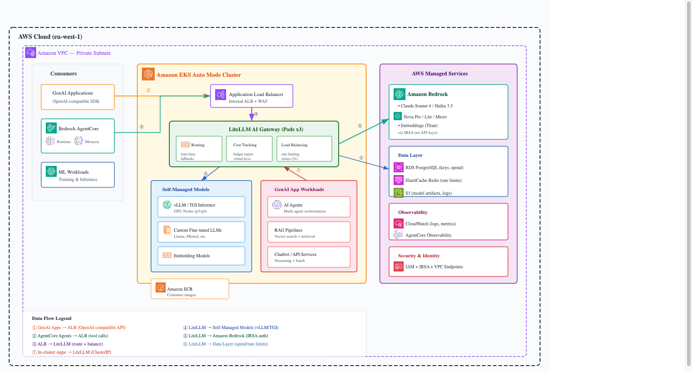

# Sample - LiteLLM Proxy with Strands Agents on Amazon Bedrock AgentCore Reference 

A Strands Agents agent deployed to Amazon Bedrock AgentCore Runtime, using a **LiteLLM Proxy** as its model gateway instead of calling Bedrock directly. This allows centralized model routing, key management, and alias resolution through the proxy.

## Architecture

```
User → AgentCore Runtime → Strands Agent → LiteLLM Proxy → Amazon Bedrock
```



The agent uses the `LiteLLMModel` provider from Strands Agents SDK. The proxy resolves model aliases (e.g. `platform.research`) to underlying provider models (e.g. `bedrock/global.anthropic.claude-opus-4-8`).

## Project Structure

```
MyAgent/
├── agentcore/
│   ├── agentcore.json        # Runtime config (VPC, env vars, build settings)
│   ├── aws-targets.json      # Deployment target (account + region)
│   ├── .env.local            # Local dev env vars (gitignored)
│   └── cdk/                  # CDK infrastructure (auto-managed by CLI)
├── app/
│   └── MyAgent/
│       ├── main.py           # Agent entrypoint (AgentCore handler)
│       ├── model/
│       │   └── load.py       # LiteLLM model loader
│       ├── mcp_client/
│       │   └── client.py     # MCP tool client
│       └── pyproject.toml    # Python runtime dependencies
└── README.md
```

## LiteLLM Configuration

The agent reads its LiteLLM connection details from environment variables:

| Variable | Description | Example |
| -------- | ----------- | ------- |
| `LITELLM_API_BASE` | LiteLLM proxy URL | `https://litellm.example.com/` |
| `LITELLM_API_KEY` | Proxy API key | `sk-...` |
| `LITELLM_MODEL_ID` | Model alias registered on the proxy | `platform.research` |

### Model Loader (`app/MyAgent/model/load.py`)

```python
import os
from strands.models.litellm import LiteLLMModel

def load_model() -> LiteLLMModel:
    """Get LiteLLM model client pointing to the LiteLLM proxy."""
    return LiteLLMModel(
        client_args={
            "api_key": os.environ["LITELLM_API_KEY"],
            "api_base": os.environ["LITELLM_API_BASE"],
            "use_litellm_proxy": True,
        },
        model_id=os.environ.get("LITELLM_MODEL_ID", "platform.research"),
    )
```

Key points:
- `use_litellm_proxy: True` tells the Strands LiteLLM provider to route through the proxy
- `model_id` uses the proxy's alias rather than a raw provider model ID
- All credentials are externalized to env vars (never hardcoded)

### Dependencies (`app/MyAgent/pyproject.toml`)

The `[litellm]` extra pulls in the litellm package:

```toml
dependencies = [
    "bedrock-agentcore >= 1.9.1",
    "strands-agents[litellm] >= 1.13.0",
    ...
]
```

### Runtime Environment (`agentcore/agentcore.json`)

Environment variables are injected into the AgentCore runtime via the `envVars` array:

```json
{
  "runtimes": [{
    "name": "MyAgent",
    "envVars": [
      { "name": "LITELLM_API_BASE", "value": "https://litellm.example.com/" },
      { "name": "LITELLM_API_KEY", "value": "sk-..." },
      { "name": "LITELLM_MODEL_ID", "value": "platform.research" }
    ]
  }]
}
```

### Local Development (`agentcore/.env.local`)

Same variables for `agentcore dev`:

```
LITELLM_API_BASE=https://litellm.example.com/
LITELLM_API_KEY=sk-...
LITELLM_MODEL_ID=platform.research
```

## Prerequisites

- **Node.js 20+**
- **Python 3.10+** and **uv** ([install uv](https://docs.astral.sh/uv/getting-started/installation/))
- **AWS CDK** installed (`npm install -g aws-cdk`)
- **AgentCore CLI** installed (`npm install -g @aws/agentcore`)
- **AWS credentials** configured with AgentCore access
- A running **LiteLLM Proxy** with your model aliases configured

## Getting Started

### 1. Configure your deployment target

Edit `agentcore/aws-targets.json` and replace the placeholders with your AWS account ID and region:

```json
[{ "name": "default", "account": "<AWS_ACCOUNT_ID>", "region": "<AWS_REGION>" }]
```

### 2. Configure VPC networking

Edit `agentcore/agentcore.json` and replace the network placeholders with your own VPC subnet and security group IDs:

```json
"networkConfig": {
  "subnets": ["<SUBNET_ID>"],
  "securityGroups": ["<SECURITY_GROUP_ID>"]
}
```

The subnet must have connectivity to your LiteLLM proxy endpoint. If using a private proxy, ensure a NAT gateway or VPC endpoint is configured.

### 3. Set your LiteLLM environment variables

Update `<LITELLM_API_BASE_URL>` in `agentcore/agentcore.json` with your proxy URL, then create `agentcore/.env.local` with your secrets:

| Placeholder / Variable | Where | Replace With |
|---|---|---|
| `<LITELLM_API_BASE_URL>` | `agentcore.json` | Your LiteLLM proxy URL (e.g. `https://litellm.internal.example.com/`) |
| `LITELLM_API_KEY` | `.env.local` only — never commit | Your proxy API key |
| `LITELLM_MODEL_ID` | `agentcore.json` / `.env.local` | Model alias on your proxy (default: `platform.research`) |

### 4. Run locally

```bash
agentcore dev
```

### 5. Deploy to AgentCore

```bash
agentcore deploy
```

### 6. Invoke

```bash
agentcore invoke "Hello, tell me about yourself"
```

## Switching Models

To use a different model alias, just change the `LITELLM_MODEL_ID` environment variable — no code changes needed. The proxy resolves the alias to the actual provider model.

## Useful Commands

| Command | Description |
| ------- | ----------- |
| `agentcore dev` | Run locally with hot-reload |
| `agentcore deploy` | Deploy to AWS |
| `agentcore invoke "prompt"` | Invoke deployed agent |
| `agentcore status` | Show deployment status |
| `agentcore logs` | Stream runtime logs |

## References

- [Strands Agents LiteLLM Provider](https://strandsagents.com/docs/user-guide/concepts/model-providers/litellm/)
- [LiteLLM Proxy Docs](https://docs.litellm.ai/docs/simple_proxy)
- [AgentCore CLI](https://github.com/aws/agentcore-cli)
- [Amazon Bedrock AgentCore](https://aws.amazon.com/bedrock/agentcore/)


## Troubleshooting Environment Variables and Networking in AgentCore Runtime

Check env is set:

```bash
aws bedrock-agentcore-control get-agent-runtime --agent-runtime-id "<YOUR_RUNTIME_ID>" --region <AWS_REGION> | grep -A2 environmentVariables
```

## Run a single command

```bash
agentcore invoke --exec --session-id "$(uuidgen)" "curl -s -o /dev/null -w '%{http_code}' <LITELLM_API_BASE_URL>"
```

## Interactive-style — reuse the same session for multiple commands

```bash
SESSION_ID=$(uuidgen)
agentcore invoke --exec --session-id "$SESSION_ID" "curl -s -o /dev/null -w '%{http_code}\n' <LITELLM_API_BASE_URL>"
```
